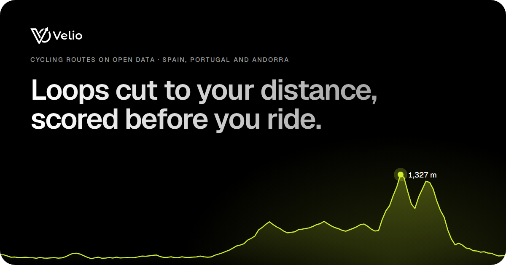
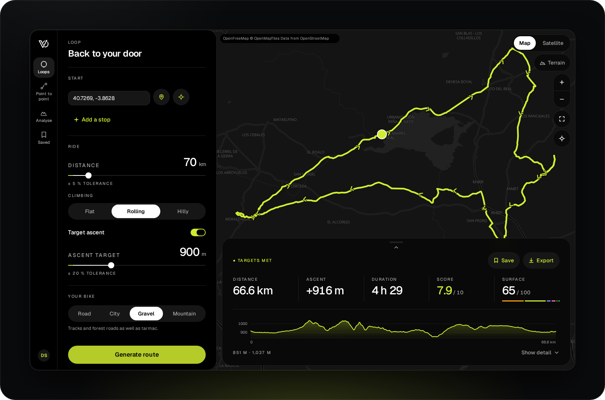
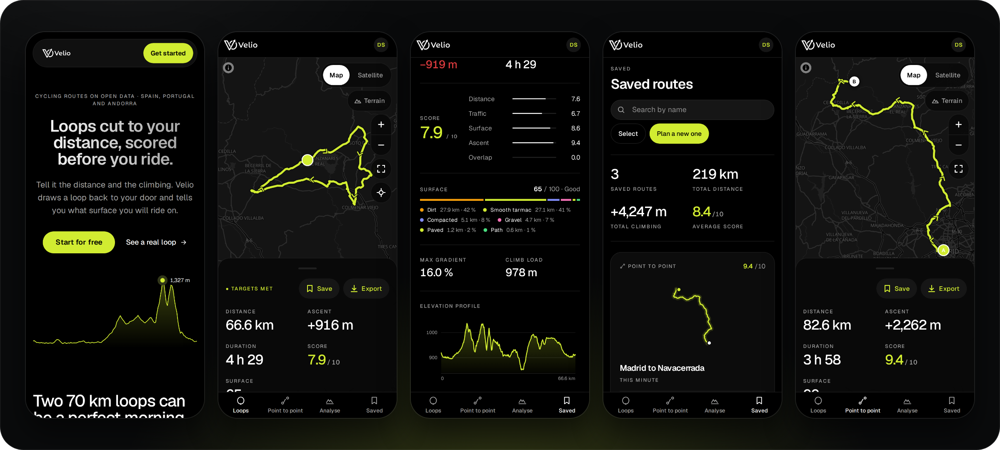

<picture>
  <source media="(prefers-color-scheme: dark)" srcset="docs/assets/logo-dark.svg">
  
</picture>

### Loops cut to your distance, scored before you ride.

Cycling routes on open data for Spain, Portugal and Andorra. Tell Velio how far and how much climbing; it draws a loop back to your door, or a route through your stops, and tells you the surface under every kilometre before you leave.

---

  

---

  

---

## 📚 Documentation

1. [Development Guide](docs/01_development.md)
2. [Deploy](docs/02_deploy.md)
3. [Backend](backend/README.md)
4. [Frontend](frontend/README.md)
5. [License](#-license)

---

## 📄 License

> Copyright (C) 2026 Diego Sanchez
>
> Velio is free software: you can redistribute it and/or modify it under the terms of the GNU Affero General Public License as published by the Free Software Foundation, either version 3 of the License, or (at your option) any later version.
>
> Velio is distributed in the hope that it will be useful, but WITHOUT ANY WARRANTY; without even the implied warranty of MERCHANTABILITY or FITNESS FOR A PARTICULAR PURPOSE. See the [GNU Affero General Public License](LICENSE) for more details.
>
> Map data © [OpenStreetMap](https://www.openstreetmap.org/copyright) contributors · elevation © Copernicus DEM GLO-30.

---

<picture>
  <source media="(prefers-color-scheme: dark)" srcset="docs/assets/logo-dark.svg">
  
</picture>

