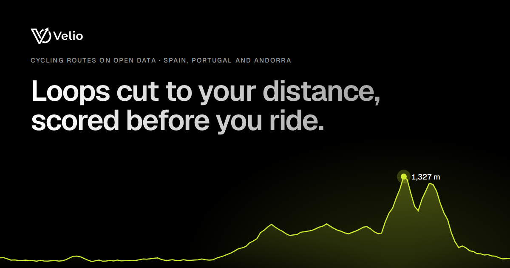
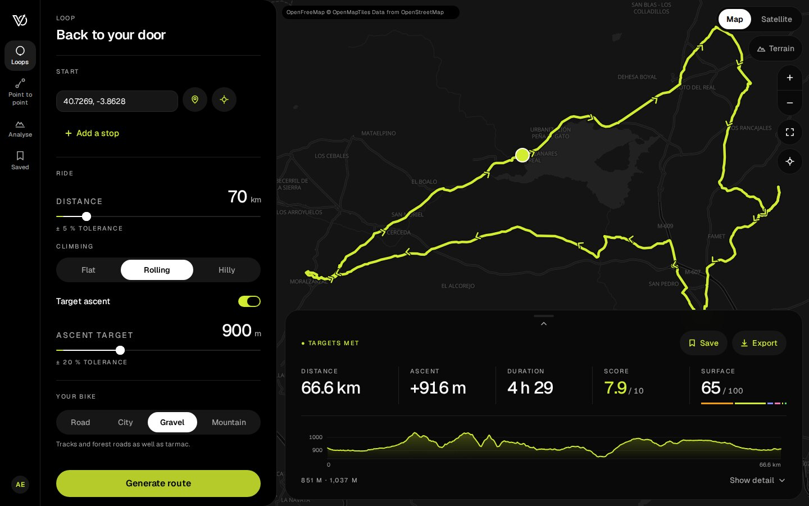
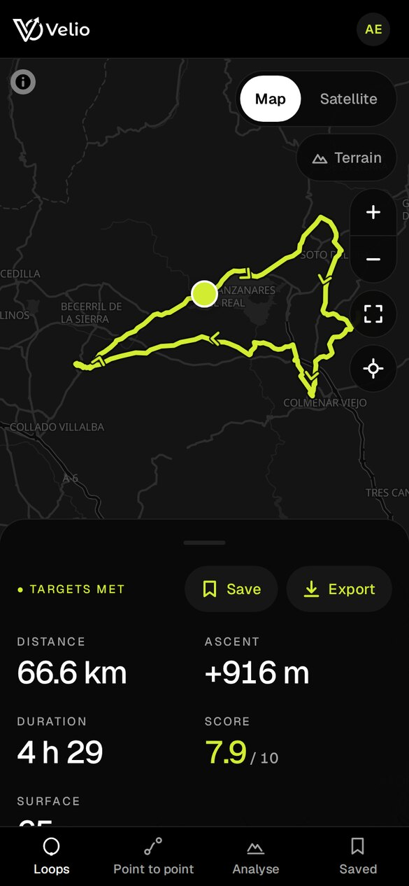
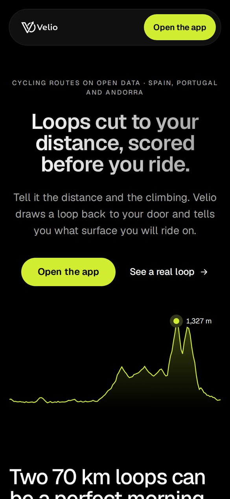

<div align="center">

<picture>
  <source media="(prefers-color-scheme: dark)" srcset="docs/assets/logo-dark.svg">
  
</picture>

### Loops cut to your distance, scored before you ride.

Cycling routes on open data for Spain, Portugal and Andorra. Tell Velio how far and how much climbing; it draws a loop back to your door, or a route through your stops, and tells you the surface under every kilometre before you leave.

[](https://github.com/CuB1z/Velio/actions/workflows/ci-backend.yaml)
[](https://github.com/CuB1z/Velio/actions/workflows/ci-frontend.yaml)




</div>

## What it does

- **Loops from your door.** Pick a distance, a climbing target and your bike (road, city, gravel or mountain); the engine places waypoints on a ring, routes them over OpenStreetMap with Valhalla, rescales until the loop fits, and reroutes any stretch that rides the same road twice.
- **A score before you ride.** Every route comes with a 0–10 score built from distance accuracy, traffic, surface for your bike, climbing and repeated road, plus the surface mix kilometre by kilometre.
- **Elevation you can trust.** Profiles, gain and grades come from the Copernicus DEM at 30 m, read straight from the tiles: 0.62 m mean error against Valhalla's own readings on a 74 km mountain route.
- **Point to point, analyse, save, export.** Plan through up to 20 stops, score a GPX you already rode, keep your routes, and export GPX with per-point elevation for Garmin, Wahoo or Komoot, or GeoJSON with every metric.

## Screenshots

<p align="center">
  
</p>

<p align="center">
  
  &nbsp;&nbsp;
  
</p>

## How it works

```mermaid
flowchart LR
    osm[("OpenStreetMap<br/>Spain · Portugal · Andorra")] --> graph["Valhalla graph<br/>(built offline)"]
    dem[("Copernicus DEM<br/>GLO-30")] --> engine
    graph --> valhalla["Valhalla<br/>routing service"]
    valhalla <--> engine["FastAPI engine<br/>ring · repair · scoring"]
    engine <--> db[("Postgres<br/>accounts · saved routes")]
    engine <--> web["React app<br/>planner · analyse · saved"]
```

## Stack

| | |
|---|---|
| **Backend** | Python 3.12 · FastAPI · SQLAlchemy (async) · Alembic · Postgres 16 · Redis 7 |
| **Routing** | Valhalla 3.8 over Geofabrik extracts · Copernicus DEM GLO-30 |
| **Frontend** | React 19 · TypeScript · Vite · Tailwind CSS v4 · HeroUI v3 · MapLibre GL |
| **Delivery** | Docker Compose · GitHub Actions · Docker Hub · Dokploy |

## Repository

```text
velio/
├── backend/        FastAPI API, routing and elevation engine, migrations, tests
├── frontend/       React web app and the prerendered landing
├── docker/         Compose files: dev, test, local full stack and Dokploy
├── docs/           Deploy guide and README assets
└── .github/        CI per side, image builds and releases
```

Each side has its own guide: [backend/README.md](backend/README.md) and [frontend/README.md](frontend/README.md).

## Getting started

The routing graph and the elevation tiles are not in git; build them once with `backend/scripts/setup_valhalla.sh` (see [backend/docs/03_valhalla.md](backend/docs/03_valhalla.md)).

```sh
# Backend: API on :8000, Valhalla on :8002, Postgres and Redis (from the repo root)
docker compose -f docker/docker-compose.test.yaml up -d --build api

# Backend tests (from backend/)
python3 -m venv .venv && .venv/bin/pip install -r requirements-dev.txt
.venv/bin/python -m pytest tests/ -q

# Frontend (from frontend/): http://localhost:5173, proxies /api to :8000
pnpm install
pnpm dev
```

The whole stack, built from source with the frontend on `localhost:8080`:

```sh
JWT_SECRET_KEY=change-me DB_USER=velio DB_PASSWORD=change-me \
  docker compose -f docker/docker-compose.yaml up -d --build
```

## Deploy

Production runs on a single VPS with Dokploy: publishing a GitHub release builds both images, pushes them to Docker Hub and redeploys `docker/docker-compose.dokploy.yaml`. DNS, environment, the routing graph on the server and the smoke test are in [docs/01_deploy.md](docs/01_deploy.md).

`dev` integrates and `main` is production; work happens on a short branch per task, fast-forwarded into `dev`.

## Data

Map data © [OpenStreetMap](https://www.openstreetmap.org/copyright) contributors, extracts by [Geofabrik](https://download.geofabrik.de/). Elevation: Copernicus DEM GLO-30. Map tiles and styles by [OpenFreeMap](https://openfreemap.org/) © [OpenMapTiles](https://www.openmaptiles.org/); satellite imagery by Esri World Imagery; relief shading from AWS Terrain Tiles.

<sub>This repository started as the backend; the web app joined under `frontend/` with `git subtree`, keeping both histories and their commit hashes (`git log 5b3578f^2 -- src/main.tsx` shows a frontend file before the import).</sub>
