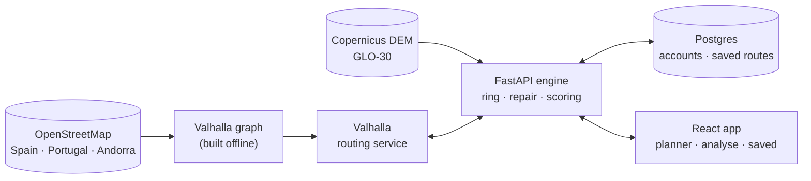

# Development

How the repository is laid out, what each side is built with, and how to run it locally.

## How it works



The engine places waypoints on a ring around the start, routes them with Valhalla, rescales until the loop fits the distance and climbing asked for, and reroutes any stretch that rides the same road twice. Every route is scored from 0 to 10 on distance accuracy, traffic, surface for the chosen bike, climbing and repeated road, and its profile is read from the Copernicus DEM at 30 m (0.62 m mean error against Valhalla's own readings on a 74 km mountain route).

## Stack

| | |
|---|---|
| **Backend** | Python 3.12 · FastAPI · SQLAlchemy (async) · Alembic · Postgres 16 · Redis 7 |
| **Routing** | Valhalla 3.8 over Geofabrik extracts · Copernicus DEM GLO-30 |
| **Frontend** | React 19 · TypeScript · Vite · Tailwind CSS v4 · HeroUI v3 · MapLibre GL |
| **Delivery** | Docker Compose · GitHub Actions · Docker Hub · Dokploy |

## Repository

```text
velio/
├── backend/        FastAPI API, routing and elevation engine, migrations, tests
├── frontend/       React web app and the prerendered landing
├── docker/         Compose files: dev, test, local full stack and Dokploy
├── docs/           This guide, the deploy guide and README assets
└── .github/        CI per side, image builds and releases
```

Each side has its own guide: [backend/README.md](../backend/README.md) (with [backend/docs/](../backend/docs/01_overview.md)) and [frontend/README.md](../frontend/README.md).

## Running it

The routing graph and the elevation tiles are not in git; build them once with `backend/scripts/setup_valhalla.sh` (see [backend/docs/03_valhalla.md](../backend/docs/03_valhalla.md)).

```sh
# Backend: API on :8000, Valhalla on :8002, Postgres and Redis (from the repo root)
docker compose -f docker/docker-compose.test.yaml up -d --build api

# Backend tests (from backend/; Docker runs a throwaway Postgres for them)
python3 -m venv .venv && .venv/bin/pip install -r requirements-dev.txt
.venv/bin/python -m pytest tests/ -q

# Frontend (from frontend/): http://localhost:5173, proxies /api to :8000
pnpm install
pnpm dev
```

The whole stack, built from source with the frontend on `localhost:8080`:

```sh
JWT_SECRET_KEY=change-me DB_USER=velio DB_PASSWORD=change-me \
  docker compose -f docker/docker-compose.yaml up -d --build
```

## Branches and releases

`dev` integrates and `main` is production. Work happens on a short branch per task, fast-forwarded into `dev`; a release fast-forwards `dev` into `main` and publishes a GitHub release, which builds the images and redeploys (see [02_deploy.md](02_deploy.md)).

This repository started as the backend; the web app joined under `frontend/` with `git subtree`, keeping both histories and their commit hashes. `git log --follow backend/app/main.py` follows a backend file; `git log 5b3578f^2 -- src/main.tsx` shows a frontend file before the import.

## Data

Map data © [OpenStreetMap](https://www.openstreetmap.org/copyright) contributors, extracts by [Geofabrik](https://download.geofabrik.de/). Elevation: Copernicus DEM GLO-30. Map tiles and styles by [OpenFreeMap](https://openfreemap.org/) © [OpenMapTiles](https://www.openmaptiles.org/); satellite imagery by Esri World Imagery; relief shading from AWS Terrain Tiles.
